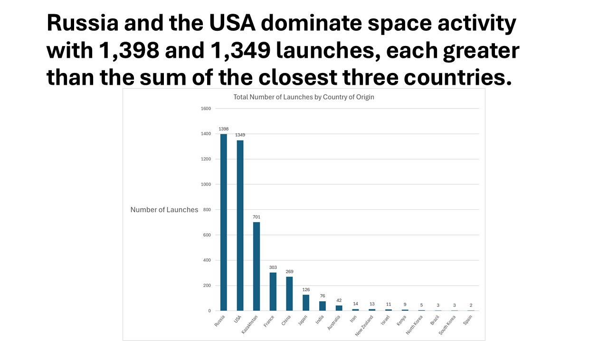
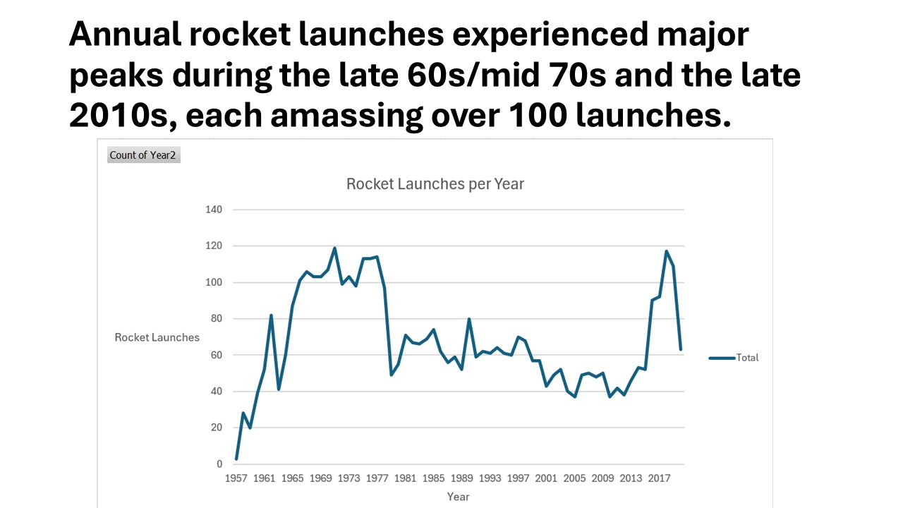
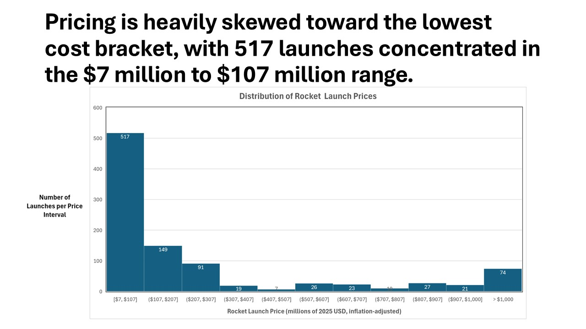

What conclusions can be made from analyzing space mission launches? Our team used pivot tables and charts to explore launch counts, success rates, history, and cost.

## Does experience affect success rate?

**Question:** Does a country's number of space launches affect its success rate?

**Method:** We made a pivot table of launch status by country of origin, then divided successes by total launches to get a success rate. We plotted launches against success rate in a scatter plot.

**Finding:** The two variables appear to follow a logarithmic distribution.

## Which countries launch the most?

**Question:** Do certain countries launch more rockets than others?

**Method:** We built a pivot table of total launches per country and charted the most active launching countries in a bar chart.

**Finding:** Russia and the USA have a much higher presence in space launches than any other country.

## How have launches changed over time?

**Question:** What is the historical distribution of annual space launches?

**Method:** We filtered the data to the relevant columns, used a pivot table to count launches per year, and graphed count vs. year.

**Finding:** *(add what the graph shows, such as when launches rose or dropped)*

## How much do launches cost?

**Question:** What is the statistical distribution of rocket launch prices?

**Method:** We adjusted each launch's cost to 2025 dollars using each year's CPI, then grouped the launches into price bins and counted them.

**Finding:** *(add what the histogram shows)*

**Note:** Many launches had no listed price and were excluded.
